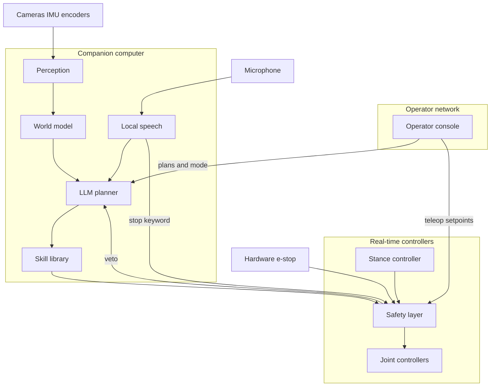
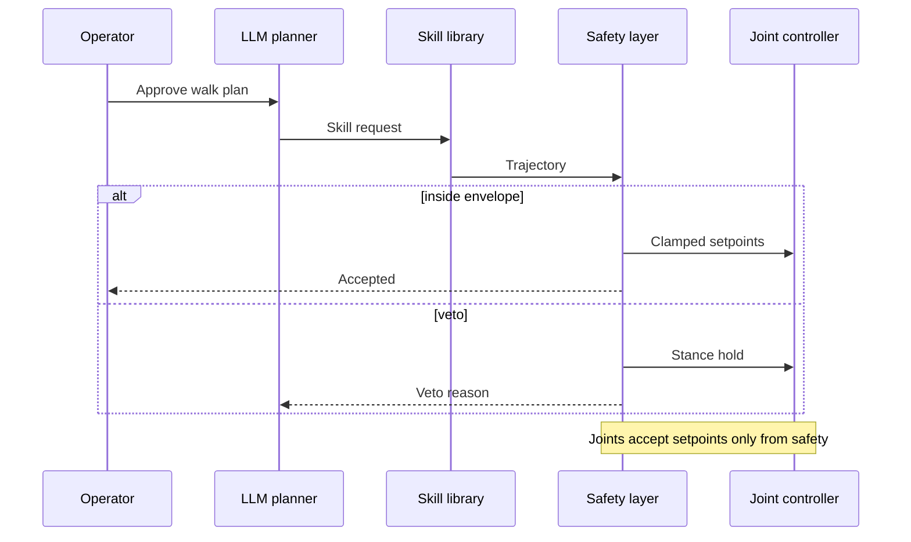
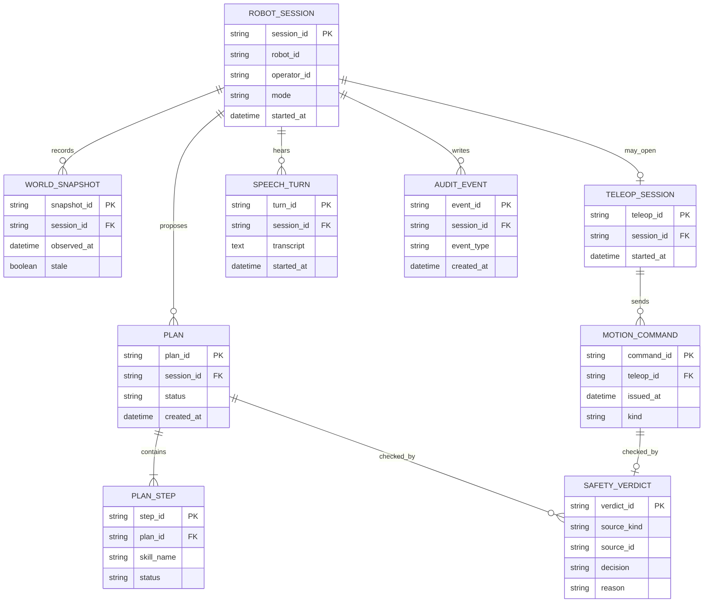

# On-robot AI stack for a humanoid

Reference design by Arpan Bom for a humanoid that keeps a person in the loop. The stack covers perception, a local speech pipeline, an LLM planner, a safety layer, and teleoperation.

This is a reference for a class of system. It does not describe a specific robot or employer. Numbers in [Capacity estimate](#capacity-estimate) are assumptions for the exercise, or arithmetic on those assumptions.

## Contents

- [Requirements](#requirements)
- [Capacity estimate](#capacity-estimate)
- [Architecture](#architecture)
- [Data model](#data-model)
- [APIs](#apis)
- [Key trade-offs](#key-trade-offs)
- [Failure modes](#failure-modes)
- [Security](#security)
- [What I would do differently](#what-i-would-do-differently)

## Requirements

### Functional

- Cameras, an IMU, and joint encoders feed a world model on the companion computer. Depth is optional.
- Wake word, streaming speech recognition, and text-to-speech run on the robot. A transcript is text into the planner. Audio stays on the device unless an operator explicitly exports a clip.
- The planner turns an instruction plus a world-model summary into a list of skill requests. A skill request names a skill and its bounds. It is not a list of joint torques.
- The skill library turns an accepted request into a trajectory. The safety layer is the only software that writes setpoints to the joint controllers.
- An operator can hold, approve a plan, or take over with teleoperation. Teleop setpoints enter the safety layer and preempt an autonomous skill.
- A hardware e-stop cuts motion without depending on speech, the planner, or the network.
- A local "stop" keyword can also request a hold. That path is a convenience. The e-stop remains the safety case.
- Mode changes, skill requests, safety verdicts, and heartbeat losses are audit events on a persistent ring.

### Design targets

These are targets chosen for the exercise, not measured results.

- Teleop setpoints reach the safety layer within 100 ms on a healthy operator link.
- A watchdog of 100 ms without a kick from the companion cuts the hardware enable.
- Autonomous skills refuse a world snapshot older than 200 ms.
- A planner call is cancelled at 8 s, and the robot returns to stance hold.
- Loss of operator state for 400 ms commands a hold. The last teleop velocity is not held.

### Out of scope

Fleet scheduling, walking research, gripper design, and any safety certification program. The fall strategy of a humanoid is a mechanical and joint-controller problem. This reference says when software must stop commanding locomotion and when the enable line must drop.

## Capacity estimate

Every number below is an assumption for the exercise, or arithmetic on those assumptions. Nothing here is a measurement from a deployment.

| Assumption | Value |
| --- | --- |
| Robots per operator session | 1 |
| Actuated joints | 25 |
| Servo loop on the joint controller | 500 Hz |
| Bytes stored per joint sample | 16 |
| World-model publish rate | 20 Hz |
| Full-rate black box | 60 s |
| Cameras streamed to the operator | 2 |
| Video uplink budget while a session is live | 4 Mbit/s |
| State and teleop uplink budget | 200 kbit/s |
| Teleop setpoint rate and payload | 50 Hz, 64 bytes |
| Operator state message | 5 Hz, 1,000 bytes, and the heartbeat is this message |
| Planner calls | at most 10 per minute |
| Onboard audit ring | 24 h |
| Gateway transcript retention | 7 days |
| Onboard image ring | 24 h |
| Allowed timestamp skew between companion and safety microcontroller | 5 ms |

Decimal units: 1 Mbit/s is 1,000,000 bits/s and 1 kbit/s is 1,000 bits/s.

| Derived figure | Result | Arithmetic |
| --- | --- | --- |
| Full-rate joint stream | 200,000 bytes/s | 25 x 500 x 16 |
| One hour of that stream | 720,000,000 bytes | 200,000 x 3,600 |
| 60 s black box | 12,000,000 bytes | 200,000 x 60 |
| 20 Hz joint summary | 8,000 bytes/s, 28,800,000 bytes/hour | 25 x 20 x 16, then x 3,600 |
| Teleop uplink | 3,200 bytes/s | 50 x 64 |
| State uplink | 5,000 bytes/s | 5 x 1,000 |
| State plus teleop | 8,200 bytes/s, under the 25,000 bytes/s budget | 200,000 / 8 = 25,000 |
| One hour of video if the budget is full | 1,800,000,000 bytes | 4,000,000 / 8 x 3,600 |

The reference keeps the 60 s black box and the 20 Hz summary. It does not store the full-rate stream for the whole session. The gateway displays video and does not store it. The image ring on the robot is for debugging and is the first thing dropped when disk is low.

## Architecture

Three clocks stay independent.

1. The joint controller runs the servo loop and a stance controller. Stance can continue inside a tight envelope during a hold. The planner does not implement balance.
2. The companion computer runs perception, speech, the world model, the planner, and the skill library.
3. The LLM planner runs on a timescale of seconds. A remote model is allowed only as a source of skill requests. The skill library and the safety layer do not care which model produced a request.

The safety microcontroller sits on the enable line. It accepts trajectories from the skill library, setpoints from teleop, and the stance controller's output. It clamps them to joint and speed limits. A veto or a watchdog timeout drops enable or commands stance hold. The companion talks to it over a local bus. Packets on that bus are still checked. "Local" is not the only control.



A supervised step looks like this.



Modes are `hold`, `teleop`, and `supervised`. Supervised autonomy runs only skills the operator has approved for that plan. There is no mode in which a remote model writes the enable line.

## Data model



`PLAN.status` is `draft`, `approved`, `running`, `done`, `cancelled`, or `vetoed`. A verdict's `source_kind` is `plan_step` or `teleop_command`. `decision` is `allow` or `veto`.

The world snapshot the planner sees is a structured summary: pose, a short obstacle list, and the snapshot time. The skill library may read the local grid when it builds a trajectory. Raw images stay in the onboard ring. Sending one frame to a remote model requires an explicit operator action on that frame.

## APIs

Operator calls use an authenticated session. Example bodies are shapes, and the values are placeholders.

| Method | Path | Who | Purpose |
| --- | --- | --- | --- |
| POST | `/v1/sessions` | Console | Open a session on one robot |
| POST | `/v1/sessions/{id}/mode` | Console | Set `hold`, `teleop`, or `supervised` |
| POST | `/v1/sessions/{id}/plans` | Planner via gateway | Store a draft plan |
| POST | `/v1/sessions/{id}/plans/{plan_id}:approve` | Console | Approve that plan version |
| POST | `/v1/sessions/{id}/plans/{plan_id}:reject` | Console | Reject it |

Video, state, and teleop setpoints ride a realtime channel bound to the same session. The HTTP API is how modes and plan approvals are recorded. It is not the setpoint pipe.

A skill request, after the library has bounds-checked it:

```json
{
  "step_id": "step_01",
  "skill": "walk_to",
  "target": { "x": 1.2, "y": 0.4, "frame": "map" },
  "max_speed_m_s": 0.4,
  "timeout_ms": 8000
}
```

The library rejects a target outside the current map, a speed above the configured max, or a timeout above the configured max. The safety layer still checks the trajectory the skill emits, because a skill can be wrong.

Onboard messages, none of which are exposed on the operator network:

| Message | From | To |
| --- | --- | --- |
| `WorldSnapshot` | Perception | Planner and skill library |
| `SkillRequest` | Planner | Skill library |
| `Trajectory` | Skill library | Safety layer |
| `TeleopSetpoint` | Operator channel | Safety layer |
| `SafetyVerdict` | Safety layer | Planner, logger, console |
| `JointSetpoint` | Safety layer | Joint controllers |

Speech is a local service with `StartTurn`, `PartialTranscript`, `FinalTranscript`, and `Speak`. `Speak` is used for short confirmations such as a hold acknowledgement.

Stable error codes on the operator API include `session_conflict`, `plan_version_mismatch`, `mode_rejected`, and `link_down`.

## Key trade-offs

### Skill boundary

An end-to-end map from pixels to joints would remove the seam an operator can read and a safety layer can veto. This reference keeps that seam. A learned policy can live inside one skill, behind the same request and trajectory types.

### Where the model runs

A remote model can propose skills when the link is up and the operator's policy allows the transcript and the world summary to leave the robot. A small local model covers the offline case and the short confirmations. If the remote call hits the 8 s target, it is cancelled. The robot holds. The remote model never becomes a dependency of the servo loop.

### Stance on the real-time side

Putting balance in the planner would mean a humanoid falls over whenever the model is slow. Stance stays next to the joint controller, inside the envelope the safety layer enforces. If stance itself cannot be maintained, enable drops. What the hardware does after that is outside this software design.

### One bus with explicit schemas

The bus can be a robotics middleware or a smaller local transport. The choice that matters is the schema and the trust boundary: network clients can produce plans and teleop setpoints, and only the safety layer produces `JointSetpoint`.

## Failure modes

| Failure | What the system does |
| --- | --- |
| World snapshot older than 200 ms | Autonomous skills refuse to start. A running walk stops. Teleop can continue only while joint-level safety is healthy and operator state is fresh |
| Planner timeout or nonsense skill | The request is rejected or cancelled. Stance hold. The operator sees the reason |
| Teleop link loss | Operator state times out at 400 ms. Hold. Last velocity is dropped |
| Companion process crash | The watchdog cuts enable within the 100 ms target |
| Safety process crash | The hardware watchdog drops enable. The companion cannot assert enable by itself |
| Clock skew above 5 ms | The session is marked degraded. Autonomous skills stop. Setpoints the safety layer cannot time-align are rejected |
| Speech mishears a command | The keyword hold is allowed to be wrong in the inconvenient direction. A missed verbal stop is why the e-stop is hardware |
| Disk full | Debug images drop first. Verdicts and mode changes stay on the audit ring |
| Unsigned skill package | The library refuses to load it |

## Security

- The console and the robot authenticate each other. A session token is bound to that robot.
- Mode changes and teleop are on that channel. A packet that shows up only on the public network has no path to the joint bus.
- The safety microcontroller does not run a general-purpose network stack or an admin shell.
- Skill packages are signed. The planner cannot push code onto the library.
- Video and transcripts on the operator link are encrypted. The retention assumptions are 7 days for gateway transcripts, no gateway video archive, and 24 h for the onboard image ring.
- Break-glass admin access to the companion is a separate path from teleop, and it is audited.

## What I would do differently

If I started this class of system again, I would lock the order below and keep the model out of it until the order is real.

1. Teleoperation through the safety layer, with a veto the operator can see, before any planner.
2. Audit events for every veto and takeover, with the world-snapshot id attached, before trying to learn from those events.
3. A boring skill request: target, constraints, timeout. A better model should be able to replace the planner without a change to the safety firmware.
4. The planner process is separate from perception. A model failure must not stall the world model.
5. A shadow mode early: the planner emits plans, nothing moves, and the operator can compare the plan to what they would have done.

## Index

[All case studies](../README.md)
