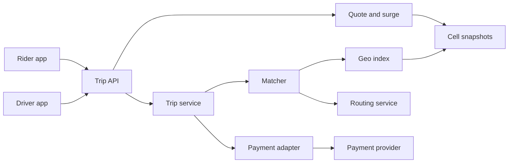
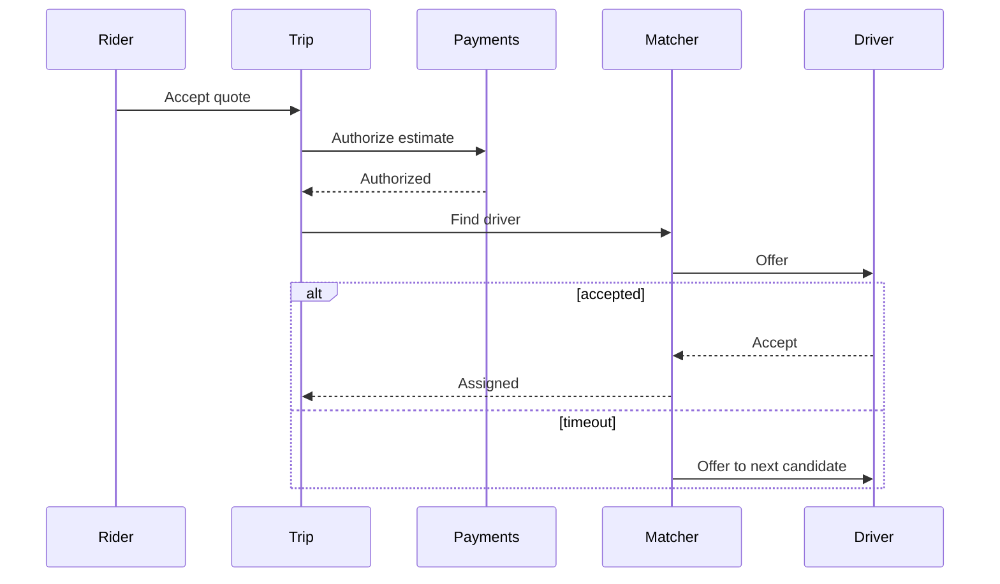
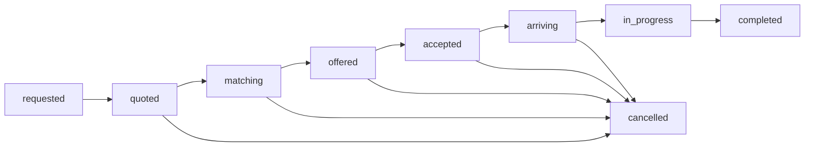
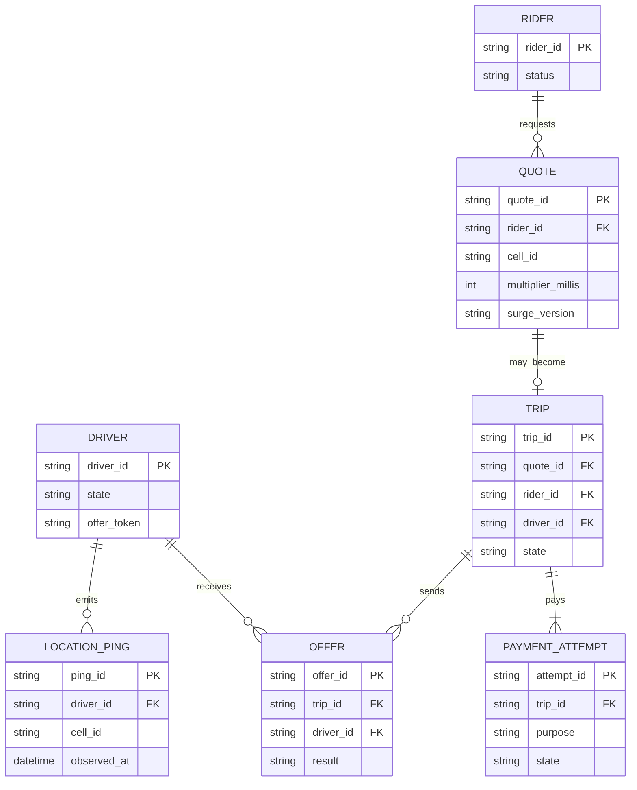

# Ride-hailing dispatch backend

Reference design by Arpan Bom for the backend that quotes a trip, matches a rider to a driver, indexes locations, publishes a surge multiplier, and coordinates payment state.

This is a reference for a class of system. It does not describe a specific company or city. Numbers in [Capacity estimate](#capacity-estimate) are assumptions for the exercise, or arithmetic on those assumptions.

## Contents

- [Requirements](#requirements)
- [Capacity estimate](#capacity-estimate)
- [Architecture](#architecture)
- [Data model](#data-model)
- [APIs](#apis)
- [Key trade-offs](#key-trade-offs)
- [Failure modes](#failure-modes)
- [Security](#security)
- [What I would do differently](#what-i-would-do-differently)

## Requirements

### Functional

- A quote is a price the rider can accept. Creating a quote does not authorize a payment and does not assign a driver.
- Accepting a quote creates one trip and authorizes the estimated amount with an idempotency key.
- Matching offers the trip to one driver at a time. A driver has at most one open offer.
- Driver locations are indexed in hex cells. The index is a cache. The trip row is the source of truth.
- Surge is a multiplier published per cell. A quote stores the multiplier it used. Later publishes do not change that quote.
- The fare is a pure function of the stored quote, the trip's distance and time inputs, and a versioned rate card. The client does not compute money.
- Capture, void, and refund are separate payment attempts. A capture happens once per trip.
- Cancel is a state transition. Completed trips are not deleted.

### Design targets

These are targets chosen for the exercise, not measured results.

- The quote API returns without waiting for a driver to respond.
- An offer lives for 8 s. A match attempt gives up after 3 offers or 20 s, whichever comes first.
- A driver whose last ping is older than 15 s is not eligible.
- If the routing service is unavailable, the trip is not offered. A straight-line guess is not used as an ETA.

### Out of scope

The rider and driver mobile clients beyond the APIs they call, map rendering, and the internals of the routing service. The routing service is a dependency with a timeout.

## Capacity estimate

Every number below is an assumption for the exercise, or arithmetic on those assumptions. The scene is one mid-size metro used as a sizing case. It is not a claim about any real service.

| Assumption | Value |
| --- | --- |
| Service area | 40 km by 40 km, one metro |
| Drivers online at the peak | 2,000 |
| New trip requests at the peak | 150 per minute |
| Location period | 4 s |
| Location ping size | 200 bytes |
| Drivers scored with the routing service | at most 15 |
| Offer timeout | 8 s |
| Offers per match attempt | at most 3 |
| Match attempt window | 20 s |
| Stale location | 15 s |
| Hex index | H3 resolution 8. Cell area comes from the pinned library, not from a hard-coded constant |
| Surge window | 10 minutes |
| Surge publish period | 60 s |
| Surge `target_ratio` | 1 |
| Surge `max_multiplier` | 3 |
| Surge smoothing weight on the new sample | 0.5 |
| Auth with no trip row, void after | 15 minutes |
| Raw ping retention | 24 h |
| Trip summary retention | 18 months |
| Rider position update during a trip | every 10 s |

| Derived figure | Result | Arithmetic |
| --- | --- | --- |
| Location updates | 500 per second | 2,000 / 4 |
| Location ingest | 100,000 bytes/s | 500 x 200 |
| One day of raw pings | 8,640,000,000 bytes | 100,000 x 86,400 |
| Requests | 2.5 per second | 150 / 60 |
| Routing calls if every request uses the full shortlist | 37.5 per second | 2.5 x 15 |
| Offers in flight if each waits the full 8 s | 20 | 2.5 x 8 |
| Trip rows if the peak ran all day | 216,000 | 150 x 60 x 24 |

216,000 rows is a sizing case for "what if the peak never dropped," not a forecast. At this size, one in-memory geo index for the metro is enough, and one writer can own offer state for a driver. If the request assumption grew by an order of magnitude, shard the cell index by region and keep a single writer per driver id so two workers cannot offer the same driver.

## Architecture



Matching:

1. The rider accepts a quote. The trip row is created. Payment authorization uses the same idempotency key as the trip create.
2. The matcher reads the pickup cell and neighboring rings. It skips drivers with a stale ping, a state other than `available`, or an open offer.
3. It ranks the rest by straight-line distance and keeps at most 15.
4. It asks the routing service for an ETA on that shortlist. If routing fails, the trip becomes `match_failed` and the auth is voided. The rider can retry.
5. It offers the best ETA. Accept, reject, and timeout are explicit. A timeout moves to the next candidate.
6. After 3 offers or 20 s, the trip is unmatched and the auth is voided.

Driver state uses compare-and-set. `available` to `offered` carries a token. `offered` to `en_route` succeeds only with that token. A second offer fails the swap.

Surge, published on a timer, not on the request path:

```text
ratio = demand / max(supply, 1)
raw = clamp(ratio / target_ratio, 1, max_multiplier)
published = (1 - alpha) * previous + alpha * raw
```

`demand` is the count of quotes with that pickup cell in the window. `supply` is the count of distinct drivers with a fresh ping in the cell and state `available`. A driver on a trip is not supply. `alpha` is 0.5 in this exercise. The quote row stores the cell, the multiplier, the config version, and the demand and supply that were published. Replay reads the row. It does not recompute surge from live counts.



Trip state:



`match_failed` and `payment_failed` are terminal siblings of `cancelled`. They stay on the row so finance can see why an auth was voided or why a completed ride was not captured.

## Data model



`PAYMENT_ATTEMPT.purpose` is `authorize`, `capture`, `void`, or `refund`. A unique key on `(trip_id, purpose)` for `capture` makes a second capture a conflict. Refunds are extra rows with their own attempt ids, keyed so a retry repeats one refund rather than creating another.

`multiplier_millis` stores 1.000 as 1000 so money math stays in integers. The example value is a storage choice, not a price from a market.

The fare function's inputs (rate card version, surge version, distance, time) are columns on the trip. A dispute adds an adjustment attempt. It does not overwrite the original fare.

## APIs

Clients send `Idempotency-Key` on quote accept and on driver location batches. Values below are placeholders.

| Method | Path | Purpose |
| --- | --- | --- |
| POST | `/v1/quotes` | Price a pickup and dropoff. No auth, no driver |
| POST | `/v1/trips` | Accept a quote and start auth plus matching |
| POST | `/v1/trips/{id}/cancel` | Cancel from the rider or driver, with a reason code |
| POST | `/v1/driver/locations` | Batch pings from one driver |
| POST | `/v1/driver/offers/{id}/respond` | Accept or reject |
| POST | `/v1/trips/{id}/events` | `arrive`, `start`, `complete` from the assigned driver |
| GET | `/v1/surge` | Published multipliers for a set of cells |

```json
{
  "quote_id": "q_1001",
  "estimate_cents": 1800,
  "currency": "USD",
  "surge_multiplier_millis": 1200,
  "surge_version": "s_14"
}
```

Payment provider webhooks are signed. An event id is unique. A replay window of 5 minutes is the assumption used to reject stale signatures. A webhook may confirm that a capture succeeded. It does not mark the trip complete. Completion is the driver's `complete` event plus a fare computed from stored inputs. If the provider then reports a capture failure, the trip becomes `payment_failed` and a person follows up. The ride still happened.

Cancellation fees are a versioned policy table keyed by trip state. This exercise does not pick amounts. The client reads the policy result from the API. Before driver accept, the reference policy is a void with no fee. The concrete fee after accept belongs in that table, not in the app.

Stable error codes include `quote_expired`, `routing_unavailable`, `offer_conflict`, `payment_declined`, and `idempotency_replay`.

## Key trade-offs

### Continuous offers at this request rate

A batch assignment every few seconds can produce better global matches and a slower tail. At 2.5 requests per second the reference offers continuously, one driver at a time, because the in-flight offer count is about 20 and the logic stays easy to fence with compare-and-set. A batch window is a later change if a single cell starts holding many unmatched requests at once. That change should keep the same trip states.

### Routing on a shortlist

Calling routing for every nearby driver would track the size of the cell, not the cap of 15. The shortlist spends the routing budget on candidates that already pass a coarse filter. The cost is a wrong coarse rank that drops a driver the road network would have preferred. The cap is there so that failure is bounded.

### Refuse when routing is down

Dispatching on straight-line distance would keep the marketplace moving and would hand drivers bad ETAs. This reference fails the match and voids the auth. The rider can retry. Availability of the marketplace is not worth a systematic lie about arrival time.

### Surge is an input to price, not a filter on drivers

Hiding drivers in order to raise the multiplier would couple matching to price in a way finance cannot replay. The multiplier is published, stored on the quote, and then ignored by the matcher.

## Failure modes

| Failure | What the system does |
| --- | --- |
| Two workers offer one driver | The compare-and-set on `offer_token` fails for one of them. That worker takes the next candidate |
| Location stream stalls | The driver ages out at 15 s and leaves the eligible set |
| Auth succeeds and the trip insert fails | The same idempotency key reads the provider result and finishes the row. A sweeper voids auths older than 15 minutes that still have no trip |
| Capture retried after a timeout | The unique `(trip_id, capture)` key returns the existing attempt |
| Routing timeout | `match_failed`, void the auth, error `routing_unavailable` |
| Webhook arrives before the trip commit | The event is stored by provider event id and applied when the attempt row exists. A duplicate event is a no-op |
| Clock skew on the surge window | The publisher uses the database clock for the window. Client clocks are not inputs |
| Hot cell | Neighbors are already part of the shortlist. If one cell's eligible set exceeds what one matcher loop can read inside the offer budget, shard by region as described in the capacity section |

## Security

- Riders and drivers have separate credentials. A driver completes only a trip whose assignment is theirs.
- Location and trip history are personal data. Raw pings last 24 hours under the assumption above. Trip summaries last 18 months. Access for support is audited.
- The rider API, after match, receives a coarsened position at the 10 s assumption. It does not receive the raw 4 s trace. After the trip, the rider API does not return the trace.
- Card numbers and security codes are not stored. The provider's customer and payment-method tokens are.
- Webhooks are signature-checked. The payment adapter is the only caller of the provider.
- Quote and location endpoints are rate-limited per credential. The limits are configuration. This note does not invent a provider quota.

## What I would do differently

If I started this class of system again:

1. I would ship the trip state machine and the idempotent payment attempts before any geo index cleverness. A wrong cell is a bad ETA. A double capture is a broken ledger.
2. I would store a reject reason on every offer, including timeout, so matching quality can be discussed from rows rather than from memory.
3. I would keep surge as a pure function of stored inputs, with the quote freezing the published number.
4. I would keep quotes and trips as different rows so a price can be shown with no payable.
5. I would keep fare math on the server and treat any client-side total as display only.

## Index

[All case studies](../README.md)
