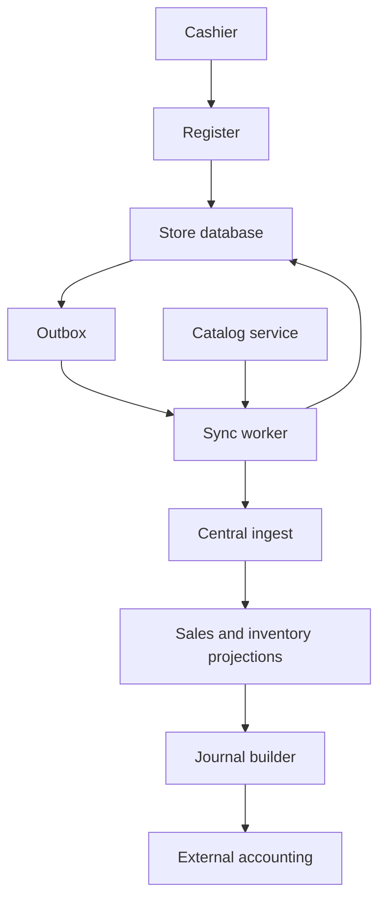
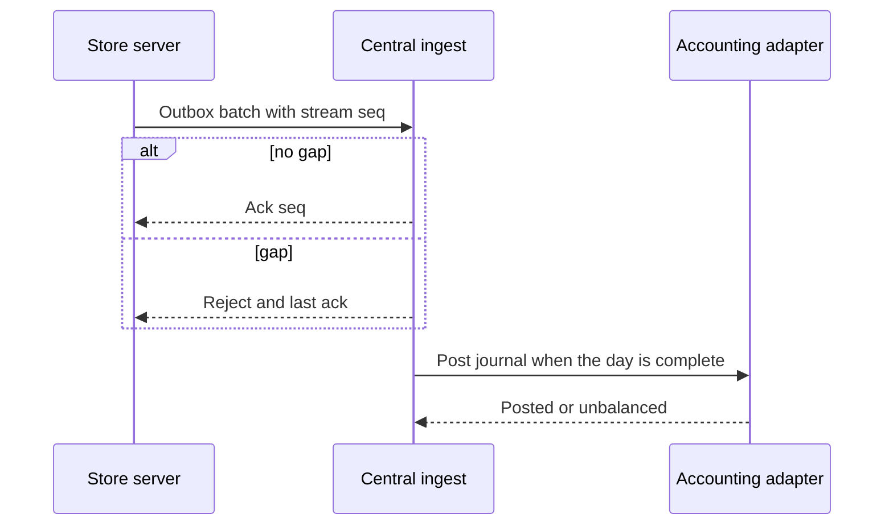
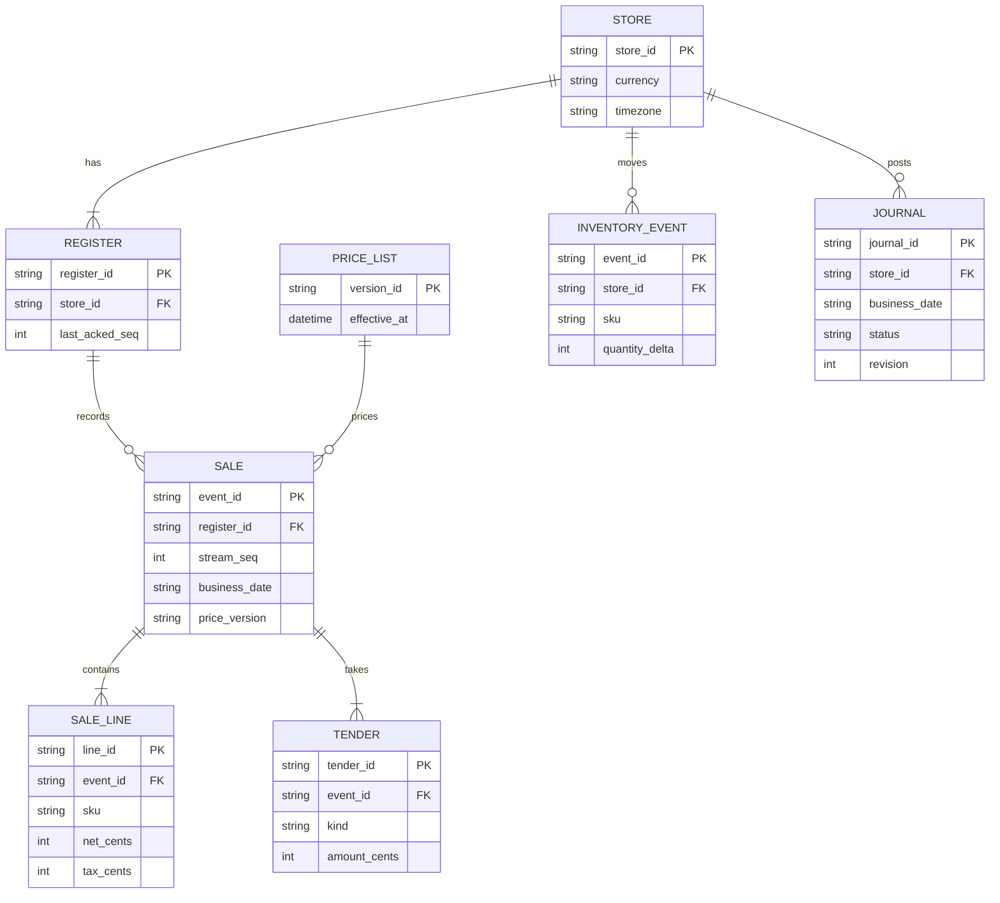

# Multi-store point of sale with offline sync

Reference design by Arpan Bom for stores that keep selling when the wide-area network is down, then sync sales, inventory movements, and tenders to a central service that posts balanced journals to an external accounting system.

This is a reference for a class of system. It does not describe a specific retailer or ledger product. Numbers in [Capacity estimate](#capacity-estimate) are assumptions for the exercise, or arithmetic on those assumptions.

## Contents

- [Requirements](#requirements)
- [Capacity estimate](#capacity-estimate)
- [Architecture](#architecture)
- [Data model](#data-model)
- [APIs](#apis)
- [Key trade-offs](#key-trade-offs)
- [Failure modes](#failure-modes)
- [Security](#security)
- [What I would do differently](#what-i-would-do-differently)

## Requirements

### Functional

- Each store has one local database. Registers sell against that database. A one-register store can run the database on the register.
- "Offline" means the store cannot reach central. Registers that cannot reach the store database cannot sell. The offline boundary is the store, so two registers in the same store share one on-hand count.
- A completed sale is an immutable event with a store-generated id and a per-register sequence. A return is a new event that references a sale. Nothing is deleted.
- The register stamps each line with the price-list version and the money amounts it charged. A later price list does not rewrite the sale.
- Card tenders complete only when the acquirer accepts them. Cash and house-account tenders can complete while the wide-area link is down. House account requires the customer to be on the last synced customer list.
- Central ingest is idempotent on event id and rejects a batch that skips a sequence number.
- A journal for a store and business date posts only when that store's stream for the date has no gaps, and only when the journal balances. A posted journal is reversed by a new journal, not edited.
- Card settlement is a separate import from the acquirer. The sale journal books card tenders to a clearing account.

### Design targets

These are targets chosen for the exercise, not measured results.

- A store keeps selling through a wide-area outage of 12 hours at the peak rate below.
- The outbox is visible to store staff as a count of events waiting for an ack.
- When the link is up and the store clock disagrees with central by more than 15 minutes, the register warns and the cashier confirms the business date. The sale still records that confirmed date.

### Out of scope

E-commerce, multi-currency baskets, payroll, and the acquirer's internal ledger. One currency per store is configuration. A basket does not mix currencies.

## Capacity estimate

Every number below is an assumption for the exercise, or arithmetic on those assumptions. In this table, 1 KB is 1,000 bytes and 1 Mbit/s is 1,000,000 bits/s.

| Assumption | Value |
| --- | --- |
| Stores | 25 |
| Registers per store | 4 |
| Peak completed sales per register | 40 per hour |
| Sale event size | 2,000 bytes |
| Outage used for sizing | 12 h at the peak rate |
| Catalog | 20,000 SKUs, 500 bytes each |
| Store uplink used for the drain sketch | 5 Mbit/s |
| Offline cashier sign-in lifetime | 12 h |
| Clock warning threshold, when online | 15 minutes |

| Derived figure | Result | Arithmetic |
| --- | --- | --- |
| Peak sales, one store | 160 per hour | 4 x 40 |
| Peak sales, all stores | 4,000 per hour | 25 x 160 |
| Peak sale traffic | 8,000,000 bytes/hour | 4,000 x 2,000 |
| One store, 12 h outbox | 1,920 events, 3,840,000 bytes | 160 x 12 x 2,000 |
| All stores, 12 h | 96,000,000 bytes | 4,000 x 12 x 2,000 |
| Uplink | 625,000 bytes/s | 5,000,000 / 8 |
| Time to send one store's sale outbox | about 6 s | 3,840,000 / 625,000 |
| Catalog snapshot | 10,000,000 bytes, about 16 s | 20,000 x 500, then / 625,000 |

The arithmetic says the wide-area link is not the hard part. A few seconds of upload clears a harsh outbox. The hard part is sequence gaps, price versions, and journals that balance. Sizing the outbox for 12 hours at peak is harsher than a typical outage. That is intentional for the exercise.

## Architecture



Sync rules:

- Each register has a `stream_seq` starting at 1. Central acks a prefix. A batch that jumps from ack 10 to event 12 is rejected. The store resends from the last ack.
- Order for the store's own events is the sequence, not the wall clock. `occurred_at` is stored and is not the sort key.
- Catalog and price lists flow down. The store keeps the last snapshot and can sell against it while the link is down.
- Central adjustments and transfers are their own events. On replay, store events and central events both apply. If on-hand goes negative, the projection raises `inventory.negative`. The sale stays. A person resolves it with a count or a shrinkage event.
- A journal runs for one store and one business date after that date's sequences are contiguous. `blocked` means the outbox is still open. `unbalanced` means the lines do not sum to zero, and nothing is posted.



Illustration of a balanced journal, using placeholder amounts. Item 10.00, discount 2.00, net 8.00, tax 0.80, cash tender 8.80.

| Account | Debit | Credit |
| --- | --- | --- |
| Cash | 8.80 | none |
| Discounts | 2.00 | none |
| Revenue | none | 10.00 |
| Tax payable | none | 0.80 |
| Total | 10.80 | 10.80 |

A card tender of the same net would debit card clearing instead of cash. Fees and the payout show up when the acquirer settlement file is imported, matched on the processor reference, and posted as a later journal. The sale journal does not guess the fee.

Tax is a pure function of price-list version, jurisdiction, and the line. The line stores the result. Replay does not compute a new tax. A wrong rate is corrected by an adjustment event.

## Data model



Money is integer cents. `TENDER.kind` is `cash`, `card`, or `house_account`. `JOURNAL.status` is `blocked`, `unbalanced`, `posted`, or `reversed`. The idempotency key sent to accounting is `store_id + business_date + mapping_version + revision`.

A return has its own `event_id`, a `return_of` sale id, and a negative quantity on its inventory event. An offline return is allowed only when that sale is already in the store database.

## APIs

| Method | Path | Where | Purpose |
| --- | --- | --- | --- |
| POST | `/sales` | Store | Commit a sale in one local transaction |
| POST | `/returns` | Store | Commit a return against a local sale |
| GET | `/catalog` | Store | Read the current local price list |
| GET | `/sync/status` | Store | Events waiting, last ack, last error |
| POST | `/sync/events` | Central | Idempotent ingest of a batch |
| GET | `/sync/catalog` | Central | Snapshot or delta since a version |
| POST | `/journals/{store_id}/{business_date}:post` | Central | Build, balance-check, and post |

Example envelope. Amounts are placeholders.

```json
{
  "event_id": "01J0SALE000000000000000001",
  "store_id": "store_12",
  "register_id": "reg_2",
  "stream_seq": 4812,
  "type": "sale.completed",
  "business_date": "2026-10-17",
  "occurred_at": "2026-10-17T14:03:11Z",
  "price_version": "pl_44",
  "payload": {
    "lines": [{ "sku": "sku_9", "net_cents": 800, "tax_cents": 80 }],
    "tenders": [{ "kind": "cash", "amount_cents": 880 }]
  }
}
```

Ack:

```json
{
  "acked_seq": 4812
}
```

Gap:

```json
{
  "error": "sequence_gap",
  "last_acked_seq": 4811
}
```

Stable error codes include `sequence_gap`, `price_version_unknown`, `house_account_unknown`, `acquirer_down`, `journal_unbalanced`, and `journal_blocked`.

## Key trade-offs

### Events, not merged rows

Two offline edits of one sale row do not have a safe merge. A sale that happened is a fact. The central projection is a fold over events. Correcting it means another event.

### One writer per store

Letting each register sell from its own snapshot would keep more of the store up when the store server fails, and it would let two registers sell the last unit. This reference chooses one local writer so the race is a database transaction. The cost is that a dead store server stops sales even when the registers still have power.

### Daily journals

Posting every sale into the external accounting API would multiply failures and reverse-noise. At 4,000 peak sales per hour the reference posts one journal per store per business date, with sale ids available for drill-down. The cost is that finance sees the day after the stream is complete, not each ticket as it happens.

### Card clearing is not settlement

Booking the card tender as revenue-and-cash would hide fees and delays. The clearing account makes the sale journal balance on the day of the sale. Settlement posts later, when the acquirer file arrives. Until that file arrives, card clearing has a balance, and that balance is the point.

## Failure modes

| Failure | What the system does |
| --- | --- |
| Duplicate delivery of an event id | Central acks it and does not apply it twice |
| Sequence gap | The batch is rejected. The store resends from `last_acked_seq` |
| Store clock wrong while offline | The cashier's confirmed `business_date` is the accounting date. `occurred_at` is kept as metadata |
| Central transfer during an outage, plus local sales | Replay applies both. Negative on-hand becomes `inventory.negative`. Sales are not voided |
| Crash after the tender drawer opens and before the commit | The transaction rolls back. The cashier repeats the tender. There is no half-posted sale |
| Card acquirer unreachable | The card tender fails with `acquirer_down`. Cash and house account still work |
| Price list arrives mid-ticket | The open ticket keeps the version it started with. The next ticket sees the new version |
| Mapping bug in a posted journal | A new revision posts a reversing journal and a replacement. The idempotency key includes the revision |
| House-account customer suspended in a later snapshot | The original tender stands. An exception is raised for review |

## Security

- Each store server has its own credential. A register syncs only its store's stream.
- Cashiers sign in locally. While the identity provider is unreachable, a cached sign-in works until the 12 h assumption, then it expires.
- Card data is not stored. The acquirer token and processor reference are.
- Journals and the outbox are financial records. The sync channel is encrypted. Reads of a journal are access-logged.
- The accounting adapter credential can post journals and cannot read cashier passwords or card tokens.

## What I would do differently

If I started this class of system again:

1. I would write the accounting mapping, including the clearing account, before the register UI. A sale that cannot become a balanced journal is not done.
2. I would put the waiting-event count on the store's main screen so an outage is visible without a database client.
3. I would version the price list and stamp every line from the first prototype, including training mode.
4. I would rehearse a restore that rebuilds central projections from a store outbox alone, and I would treat a failed rehearsal as a blocked release.
5. I would keep tax as a pure function and store its result, so a code change cannot quietly reprice history.

## Index

[All case studies](../README.md)
