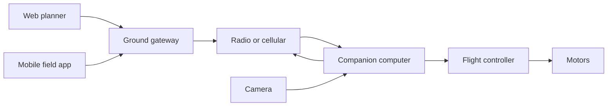
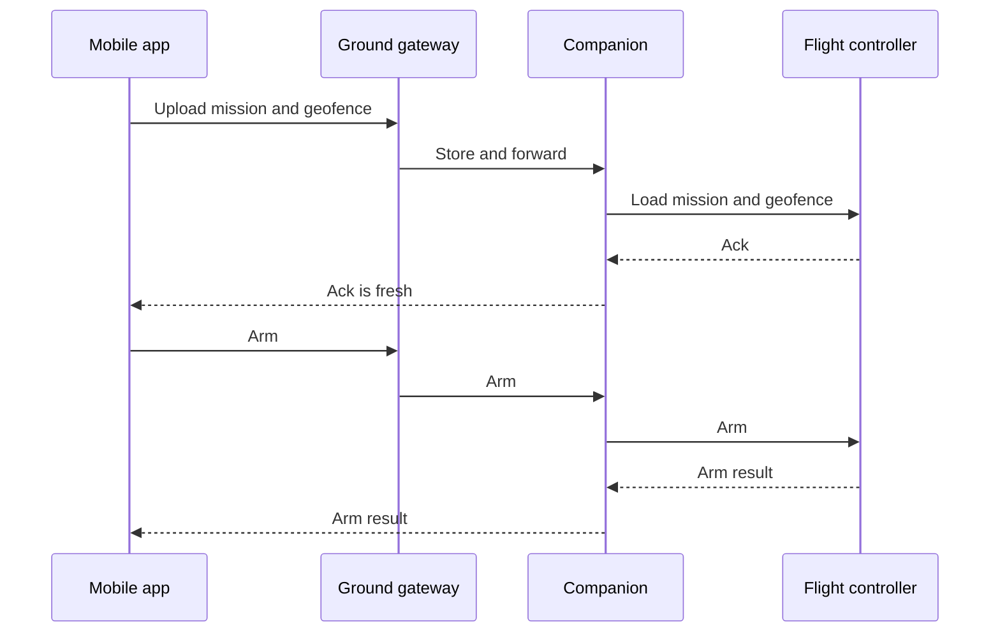
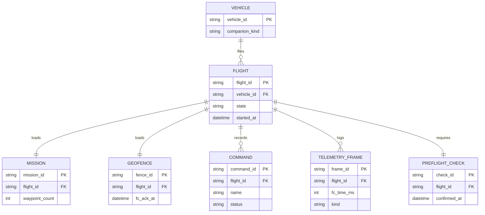

# Drone mission control

Reference design by Arpan Bom for a small multirotor or fixed-wing on inspection work. A companion computer, NVIDIA Jetson or Raspberry Pi, sits next to a flight controller. A web app plans missions. A mobile app is the field control. Telemetry and mission commands cross the link between them.

This is a reference for a class of system. It does not describe a specific aircraft or operator. Numbers in [Capacity estimate](#capacity-estimate) are assumptions for the exercise, or arithmetic on those assumptions.

## Contents

- [Requirements](#requirements)
- [Capacity estimate](#capacity-estimate)
- [Architecture](#architecture)
- [Data model](#data-model)
- [APIs](#apis)
- [Key trade-offs](#key-trade-offs)
- [Failure modes](#failure-modes)
- [Security](#security)
- [What I would do differently](#what-i-would-do-differently)

## Requirements

### Functional

- The flight controller owns attitude, motors, GPS-loss behavior, battery failsafe, return-to-launch, and the geofence. The companion sends setpoints and mission items upward. It is not required for the aircraft to stay in the air.
- A mission of waypoints and a geofence are uploaded to the flight controller. Both must be acknowledged before the companion will forward an arm command.
- The transmitter is the manual stick path and talks to the flight controller. The phone and the browser send mission-level commands: arm, disarm, start, pause, return-to-launch. Virtual sticks are out of scope.
- The link prefers a local radio and can use a cellular path as backup. Command acknowledgements and pose outrank video when the buffer fills.
- The aircraft carries the mission it will fly, so a dropped link mid-mission does not depend on the cloud.
- Web is for drawing a mission and reviewing a log. Mobile is for the preflight checklist, arm, and live status. Both speak the same command schema.
- Every command has an id. A retry repeats that id. The companion and the flight controller treat a repeat as the same command.

### Design targets

These are targets chosen for the exercise, not measured results.

- Pose telemetry is offered at 10 Hz. Health is offered at 1 Hz. The link may deliver less. The latest pose replaces an unsent older pose.
- An arm command is forwarded only when the geofence ack and the mission ack are both newer than 60 s and the preflight checklist id matches this flight.
- A client may send at most 5 commands per second. Further commands are rejected.

### Out of scope

Swarming, detect-and-avoid as a certified function, and using the phone as the only radio. Onboard detection, if the companion is a Jetson, may annotate video. It does not publish setpoints. A Pi companion can omit detection and keep the same command contract.

## Capacity estimate

Every number below is an assumption for the exercise, or arithmetic on those assumptions. One aircraft and one operator.

| Assumption | Value |
| --- | --- |
| Aircraft in a session | 1 |
| Pose rate and size | 10 Hz, 120 bytes |
| Health rate and size | 1 Hz, 200 bytes |
| Flight used for sizing | 30 minutes |
| Waypoints in one mission | at most 200, 64 bytes each |
| Video budget | 3 Mbit/s, decimal |
| Command cap | 5 per second |
| Ack freshness required to arm | 60 s |

| Derived figure | Result | Arithmetic |
| --- | --- | --- |
| Pose stream | 1,200 bytes/s | 10 x 120 |
| Pose log for a 30 minute flight | 2,160,000 bytes | 1,200 x 1,800 |
| Health for that flight | 360,000 bytes | 200 x 1,800 |
| Mission body | 12,800 bytes | 200 x 64 |
| Video for 30 minutes if the budget stays full | 675,000,000 bytes | 3,000,000 / 8 x 1,800 |

Pose and health logs are small. A full video budget for the same flight is 675,000,000 bytes, so video stays a live stream that yields the radio. A mission that needs pictures stores stills or a short clip by an explicit mission flag. The flight controller keeps its own log beside this one.

## Architecture



Link scheduler on the companion, highest priority first:

1. Command acknowledgements and failsafe state.
2. Latest pose and battery.
3. Mission progress.
4. Video frames.

When the send buffer passes its configured high-water mark, drop video first, then replace unsent pose with the latest pose. An unacked command stays in the queue.

| Condition | Flight controller | Companion | App |
| --- | --- | --- | --- |
| Radio lost | Runs the mission's configured failsafe, usually return-to-launch | Keeps the local mission log | Shows link lost |
| Companion crash | Continues. Failsafe is unchanged | Down | Shows companion down |
| GPS lost | Runs its GPS-loss behavior | Reports the state | Has no override |
| Geofence or mission not acked | Refuses arm | Refuses to forward arm | Arm control stays disabled |
| Battery low | Runs its battery failsafe | Reports it | Displays it |



Logs on the companion use flight-controller boot time plus a sampled offset, so a comparison of the two logs has a recorded clock relationship. After landing, or when the live link is idle, the companion uploads the flight log to the ground gateway.

## Data model



`COMMAND.name` is `arm`, `disarm`, `start_mission`, `pause`, or `rtl`. `COMMAND.status` is `accepted`, `rejected`, or `timed_out`. `companion_kind` is `jetson` or `pi` and changes only whether the detection subscriber is present.

`FLIGHT.state` is `planning`, `preflight`, `armed`, `flying`, `rtl`, or `closed`. The app's state is a copy of acknowledgements. The flight controller's state wins when they disagree, and the app shows both if they differ.

## APIs

| Method | Path | Purpose |
| --- | --- | --- |
| POST | `/v1/missions` | Create a mission and its waypoints |
| POST | `/v1/flights` | Open a flight that pins a mission and a geofence |
| POST | `/v1/flights/{id}/preflight` | Record the checklist confirmation |
| POST | `/v1/flights/{id}/commands` | Send a command id and a name |
| GET | `/v1/flights/{id}/commands/{command_id}` | Read the ack |
| GET | `/v1/flights/{id}/telemetry` | Socket of pose, health, and link state |

Example command. The id is the idempotency key.

```json
{
  "command_id": "c_1001",
  "vehicle_id": "v_7",
  "name": "start_mission",
  "mission_id": "m_44"
}
```

Ack:

```json
{
  "command_id": "c_1001",
  "status": "accepted",
  "fc_ack": true
}
```

The companion's local API on the aircraft network is the same command schema, so a bench setup can talk to it without the ground gateway. That listener does not bind to a public address.

Stable error codes include `fence_not_acked`, `mission_not_acked`, `preflight_mismatch`, `command_rate_limited`, `fc_rejected`, and `link_down`.

## Key trade-offs

### Companion is optional for flight

Putting the mission runner only in the cloud would make a link loss end the flight in software. Putting the attitude loop on the companion would make a Linux scheduling stall a flight event. The flight controller already has both jobs in this class of aircraft. The companion stores the mission, supervises progress, and talks to people.

### Jetson and Pi share a contract

Detection is useful on a Jetson and a poor fit for a Pi. Shipping two command APIs would split the apps. The reference keeps one command schema. Detection subscribes to frames and publishes annotations. It has no setpoint publisher.

### Web plans, mobile flies the checklist

One UI for a desk and a field tends to hide the arm button among planning tools, or hide the map among giant buttons. Two clients share the schema and the flight row. The cost is two clients to ship. The command list is short on purpose so that cost stays small.

### Video yields

A full video budget of 675,000,000 bytes per 30 minutes is the reason video is the first drop. Operators sometimes want the opposite priority. The failsafe table is the reason this reference refuses that: a lost pose or a lost ack is an aircraft problem, and a lost frame is a picture problem.

## Failure modes

| Failure | What the system does |
| --- | --- |
| Link loss mid-mission | The flight controller runs the configured failsafe without waiting for the app. The companion keeps logging |
| Duplicate arm retry | The same `command_id` returns the original ack |
| Geofence edited in the app after the ack | The ack is stale past 60 s, or the fence version no longer matches, and arm is refused until a new ack |
| Companion disk full | Video stills stop first. Command and ack rows for the open flight stay |
| Client crash after sending arm | The command row is the record. On reconnect the app reads it instead of sending a second id |
| GPS loss | The app displays the flight controller's state. There is no "force GPS" command |
| Detection process uses the CPU | It is a separate process with no setpoint socket. The link scheduler still prefers acks and pose |

## Security

- The vehicle holds a device key. The operator holds an account. The ground gateway ties a flight to both.
- The command channel is mutually authenticated. On a cellular path that is TLS with the device key. On a local radio it is the radio's own pairing. This reference does not invent a new radio cipher.
- Arm requires a fresh geofence ack, a fresh mission ack, and a matching preflight id. The companion will not forward arm on a missing check to "save a click."
- The companion's command listener is on the aircraft network or the authenticated link, not on an open public port.
- Flight logs can show private sites. Access is limited to the operator's organization, and the retention assumption is 90 days unless someone exports a copy. An export is an audited event.

## What I would do differently

If I started this class of system again:

1. I would write the failsafe table before any map UI, and I would test link loss against that table on a simulated flight controller before flying.
2. I would record command and ack pairs as the audit log from the first day, including rejects.
3. I would generate the web and mobile command types from one schema so the two clients cannot drift.
4. I would keep detection off the arming path permanently, not as a temporary cleanup.
5. I would treat the flight controller log and the companion log as a pair, with the clock offset stored, so a later review does not guess which clock a timestamp used.

## Index

[All case studies](../README.md)
