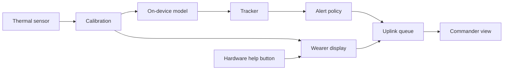
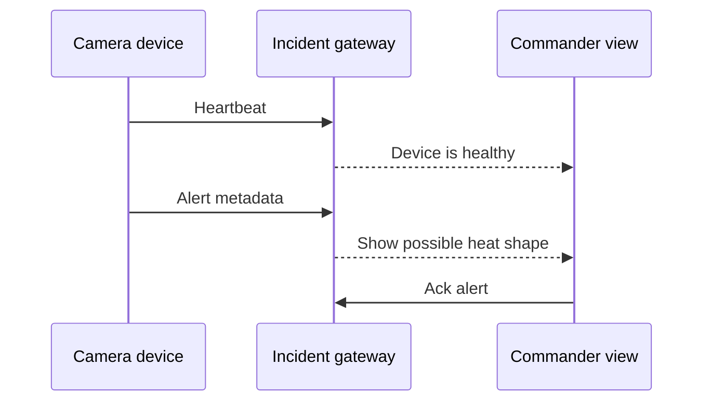
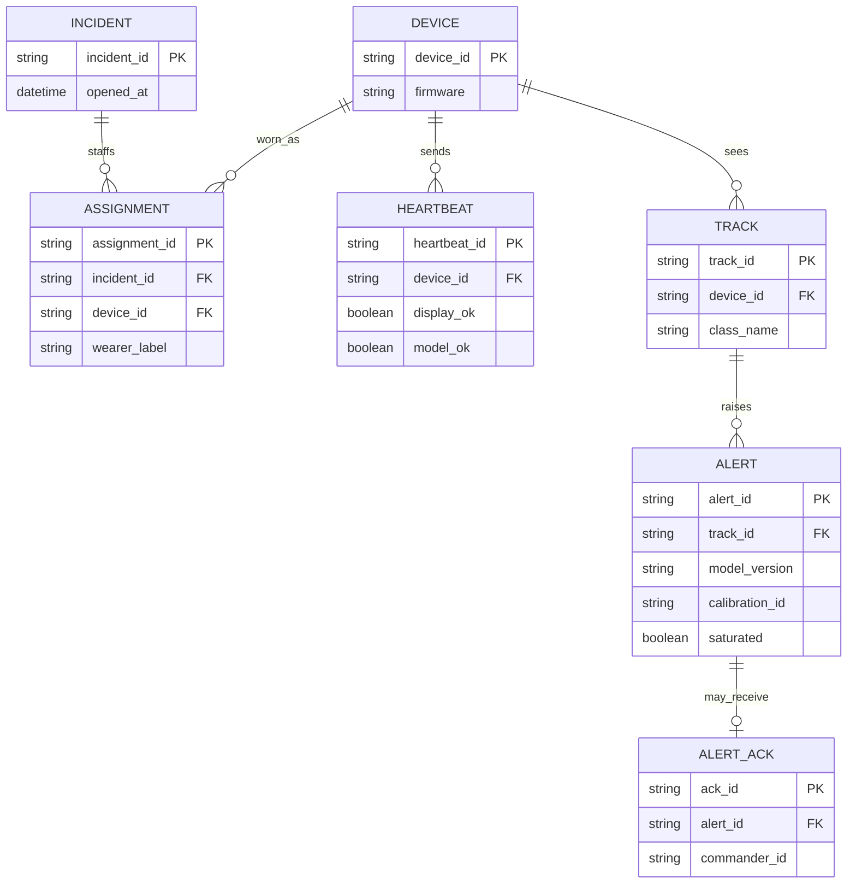

# Edge thermal camera pipeline for firefighters

Reference design by Arpan Bom for a wearable or handheld thermal camera that shows a colormap to the wearer, runs a small on-device model, and sends compact alerts to an incident commander.

This is a reference for a class of system. It is an aid for people who already have a task. It is not a certification of a life-safety device, and it does not describe a specific department's equipment. Numbers in [Capacity estimate](#capacity-estimate) are assumptions for the exercise, or arithmetic on those assumptions.

## Contents

- [Requirements](#requirements)
- [Capacity estimate](#capacity-estimate)
- [Architecture](#architecture)
- [Data model](#data-model)
- [APIs](#apis)
- [Key trade-offs](#key-trade-offs)
- [Failure modes](#failure-modes)
- [Security](#security)
- [What I would do differently](#what-i-would-do-differently)

## Requirements

### Functional

- The wearer sees a thermal colormap on a short path from the sensor. That path stays up when the model process is down.
- A second path reads the radiometric frame, finds regions, and tracks them. Classes are `hotspot` and `possible_person`. There is no class named as a confirmed person.
- The commander view receives heartbeats, alert metadata, and thumbnails when the link allows. Copy on that view uses "possible heat shape" for `possible_person`.
- A hardware help button is read by the display process, which is the process that is supposed to stay up. The button is not a model output.
- Alerts for a track are sent when the track is created, when its class changes, or when it reappears after a loss. The local overlay may update every frame.
- If a large share of the frame is clipped at the sensor maximum, `possible_person` is suppressed for that frame. The wearer still sees the colormap.
- Each alert stores the model version and the sensor calibration id.

### Design targets

These are targets chosen for the exercise, not measured results.

- Display frames are produced at 9 Hz and do not wait on inference.
- Inference runs at 3 Hz.
- A heartbeat every 2 s carries display health, model health, battery, and last frame age.
- The commander raises an alarm when heartbeats have been missing for 6 s. Model-down with heartbeats still arriving is a quieter indicator.
- The on-device raw ring keeps 10 minutes at 1 Hz. Full-rate video is not retained for hours.

### Out of scope

Certification, breathing-gear integration, and a claim about detection quality. Thresholds are incident configuration. This note does not set a quality target for the model's score.

## Capacity estimate

Every number below is an assumption for the exercise, or arithmetic on those assumptions.

| Assumption | Value |
| --- | --- |
| Cameras on one incident | 12 |
| Frame | 640 by 480 radiometric samples, 2 bytes each |
| Display rate | 9 Hz |
| Model rate | 3 Hz |
| Heartbeat | every 2 s, 200 bytes |
| Alert metadata | 400 bytes |
| Thumbnail | 30,000 bytes |
| Sizing-case alert rate | 4 alerts per minute per camera |
| Per-camera uplink budget | 100 kbit/s, decimal, so 12,500 bytes/s |
| Saturated frame | 50 percent of pixels near the sensor maximum |
| Track association | intersection over union above 0.3 |
| Raw ring | 1 Hz for 10 minutes |
| Retention after the incident is closed | 30 days, unless a hold is set |

| Derived figure | Result | Arithmetic |
| --- | --- | --- |
| One radiometric frame | 614,400 bytes | 640 x 480 x 2 |
| Full-rate stream, one camera | 5,529,600 bytes/s | 614,400 x 9 |
| Four hours at full rate, one camera | 79,626,240,000 bytes | 5,529,600 x 14,400 |
| Raw ring, 10 minutes at 1 Hz | 368,640,000 bytes | 614,400 x 600 |
| Heartbeats for 12 cameras | 1,200 bytes/s | 12 x 200 / 2 |
| Thumbnails at the sizing-case rate, one camera | 2,000 bytes/s | 4 x 30,000 / 60 |
| Thumbnails at that rate, 12 cameras | 24,000 bytes/s | 12 x 2,000 |
| Metadata at that rate, 12 cameras | 320 bytes/s | 12 x 4 x 400 / 60 |
| Device-side inferences | 3 per second per camera, 36 per second on the incident | 12 x 3 |

79,626,240,000 bytes is why a wearable does not keep full-rate radiometric video for a shift. 368,640,000 bytes is the ring this exercise actually keeps. The per-camera thumbnail load of 2,000 bytes/s fits inside the 12,500 bytes/s budget. Twelve cameras together at 24,000 bytes/s fit a truck network and may not fit one narrow shared radio. The queue therefore sheds thumbnails before metadata, and it never sheds the help button. Only the latest heartbeat is retained in the queue, so a stalled radio cannot fill up with old heartbeats and delay a help press.

## Architecture

Two processes on the device, plus a radio process:

- Capture, calibration, colormap, and the wearer display. This process also samples the help button.
- Model and tracker. If it dies, the display continues and heartbeats say the model is down.
- Policy and radio. Priorities: help button, latest heartbeat, alert metadata, thumbnail.



The first detector behind the region interface is a temperature threshold plus a minimum region size. A learned model is a later implementation of the same interface. The commander protocol does not change when the implementation changes.



A heartbeat includes `display_ok`, `model_ok`, battery, and `last_frame_age_ms`. The commander treats a missing heartbeat as "we cannot see this device," which is a different sentence from "the model is down."

## Data model



`class_name` is `hotspot` or `possible_person`. `saturated` on an alert is a record of the frame state. The policy suppresses `possible_person` when `saturated` is true, so those rows should not appear. The flag still exists so a bug that sends one is visible.

`wearer_label` is the name the commander sees. It is an assignment, not a serial number baked into the alert copy, so a camera can be handed to another person only by closing and opening an assignment.

Scores from the model are stored on the alert when the implementation produces them. This reference does not treat a score as a probability that a person is present, and it does not set a pass mark for model quality.

## APIs

Devices publish to an incident gateway. The commander reads from that gateway. Example values are placeholders.

| Method | Path | Who | Purpose |
| --- | --- | --- | --- |
| POST | `/v1/incidents/{id}/heartbeats` | Device | Latest health |
| POST | `/v1/incidents/{id}/alerts` | Device | Metadata, thumbnail optional |
| GET | `/v1/incidents/{id}/live` | Commander | Socket of heartbeats and alerts |
| POST | `/v1/alerts/{id}/ack` | Commander | Record who saw it |

```json
{
  "alert_id": "a_1",
  "device_id": "cam_3",
  "incident_id": "inc_9",
  "class_name": "possible_person",
  "region": { "x": 10, "y": 20, "w": 30, "h": 40 },
  "temp_c": { "min": 28.0, "max": 36.5, "mean": 33.1 },
  "model_version": "threshold-0.1.0",
  "calibration_id": "cal_7",
  "saturated": false
}
```

`temp_c` is taken from the radiometric frame. The thumbnail is a colormap image for a person to look at, not a scientific record. The numbers in the example are placeholders for the shape of the message.

Stable error codes include `unknown_device`, `incident_closed`, `thumbnail_shed`, and `assignment_required`.

## Key trade-offs

### Display first

Running the colormap through the model would make a model crash a blank screen in a dark building. The display process owns the sensor and the screen. The model subscribes. The cost is two consumers of the frame and a calibration step that must be shared so the overlay lines up.

### On the device, because the stream does not fit

5,529,600 bytes/s per camera cannot be the uplink. A model at the truck would need that stream or a heavy compression design this exercise does not take on. The device sends events. The cost is a harder model update: a version rides with the firmware or a signed package, and every alert names the version that produced it.

### Commander alerts are the quieter stream

The local overlay can show weaker regions. The commander channel sends track-level alerts above the incident's configured threshold. This is a product choice about attention, not a measured receiver-operating curve. The threshold is stored on the incident and copied onto the alert.

### Threshold detector before a learned model

A learned model needs a labeled set this note does not pretend to have. A threshold plus a minimum size already produces regions, tracks, and alerts, and it gives the radio and the commander UI something real to fail against. The learned model replaces the region finder later.

## Failure modes

| Failure | What the system does |
| --- | --- |
| Model process crash | Display continues. Heartbeats set `model_ok` false. Commander shows model down, not a missing firefighter |
| Radio process crash or link loss | Help presses stay on the local recording. Heartbeats stop. Commander alarms at 6 s |
| Display process crash | Heartbeats report `display_ok` false if the radio process is still up. Otherwise heartbeats stop |
| Saturated scene | `possible_person` is suppressed. The colormap remains |
| Queue backup | Drop thumbnails, coalesce metadata to the latest per track, keep only the latest heartbeat, keep help presses in order |
| Camera assigned to the wrong person | Close the assignment. Alerts already sent keep the assignment id they had |
| Clock on the device is wrong | The device sends a monotonic timestamp. The gateway stores receive time as well |
| Compute module throttles | Model rate drops before display rate |

## Security

- This is an aid. API copy and UI copy stay on `possible_person` and "possible heat shape."
- Each camera has a device key. Alerts are signed so a third party on the incident network cannot inject one.
- Imagery of people at an incident is personal data. The raw ring stays on the device and is encrypted. Thumbnails are incident-scoped. The retention assumption is 30 days after the incident closes, unless a hold is set.
- A help press is a hardware line into the display process. The model cannot raise it, and the model cannot clear it.
- Export of a clip is an audited action by someone assigned to the incident.

## What I would do differently

If I started this class of system again:

1. I would put the wearer display on a small microcontroller separate from the model module, so a model crash is physically not a blank screen.
2. I would ship the threshold detector, the heartbeat, and the shed order before any learned weights.
3. I would log model version, calibration id, and the incident's threshold on every alert from the first prototype.
4. I would practice the model-down and saturated screens with firefighters before adding classes.
5. I would keep the commander protocol versioned and dull, so a model change is not a protocol change.

## Index

[All case studies](../README.md)
