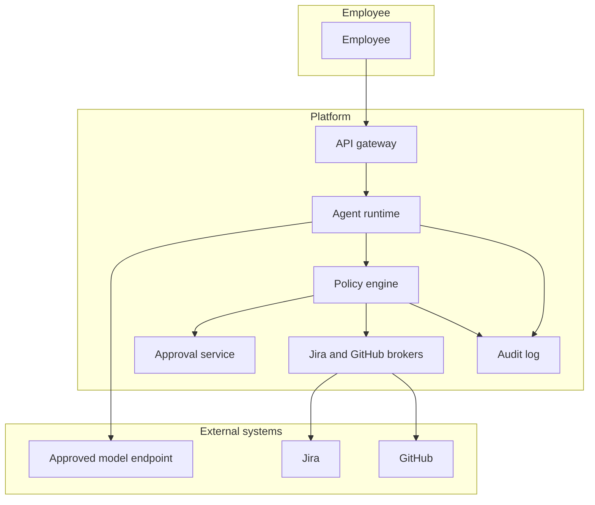
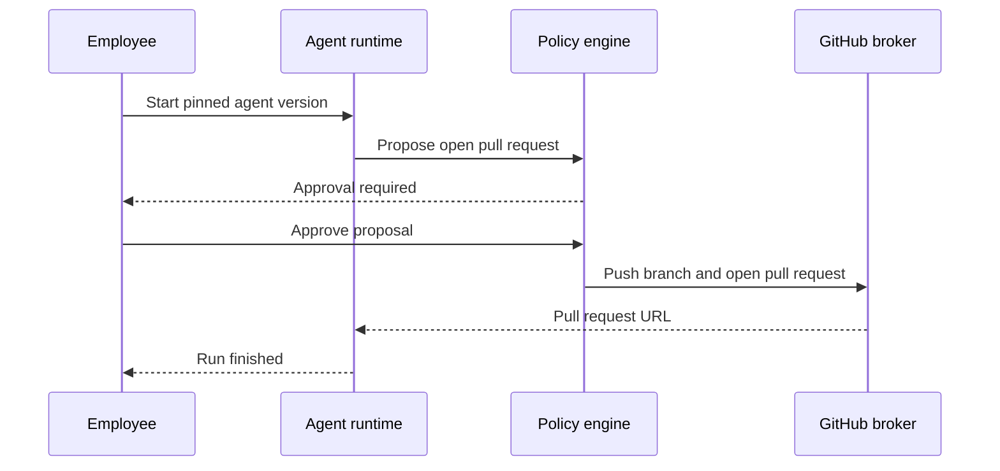
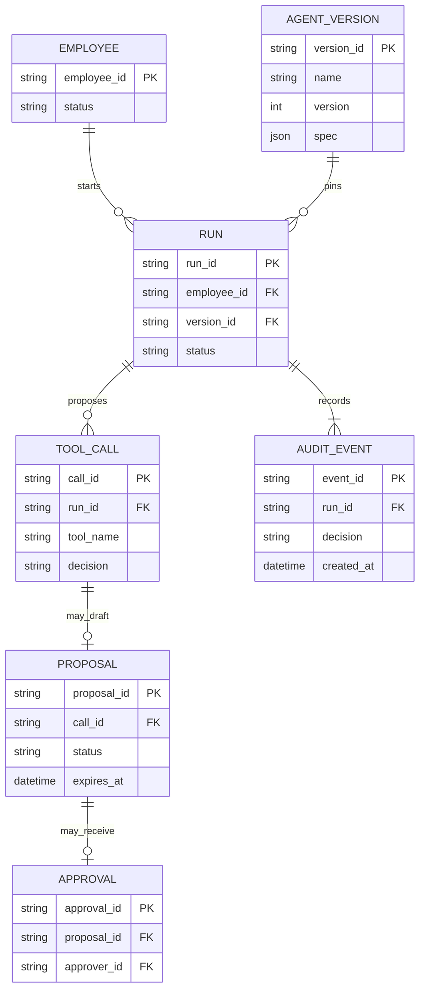

# Enterprise LLM agent platform

Reference design by Arpan Bom for a platform where employees run task-specific agents against Jira and GitHub. Agents can read, draft, and, after a person approves, comment or open a pull request. A policy engine outside the model is the control.

This is a reference for a class of system. It does not describe a specific company's tickets, repositories, or model vendor. Numbers in [Capacity estimate](#capacity-estimate) are assumptions for the exercise, or arithmetic on those assumptions.

## Contents

- [Requirements](#requirements)
- [Capacity estimate](#capacity-estimate)
- [Architecture](#architecture)
- [Data model](#data-model)
- [APIs](#apis)
- [Key trade-offs](#key-trade-offs)
- [Failure modes](#failure-modes)
- [Security](#security)
- [What I would do differently](#what-i-would-do-differently)

## Requirements

### Functional

- An employee signs in with the company identity provider and runs a named agent at a pinned version.
- An agent spec lists the model alias, the tool allowlist, the repository allowlist, the Jira project allowlist, and the write policy. Changing a spec creates a new version. A run stores the version it used.
- Tools in this reference: Jira search, Jira read, Jira comment draft, GitHub read, GitHub search, GitHub pull-request draft. There is no deploy tool and no secret-store read.
- The model proposes a tool call. The policy engine decides `allow`, `deny`, or `require_approval` from the tool name and the arguments. Text inside a ticket or a file is not an instruction to the policy engine.
- The default write policy is approval before any side effect. For GitHub, approval happens before the branch is pushed. For Jira, approval happens before the comment is posted.
- Brokers call Jira and GitHub with the employee's own permission. A run cannot read a project the employee cannot read. A 403 is the end of that call. There is no fallback service account.
- Secret scanning runs on drafts and diffs before a broker sends them. A hit stops the run and stores a redacted copy.
- An audit record is appended for each decision: actor, run, agent version, model alias, tool, redacted arguments, decision, approver.

### Design targets

These are targets chosen for the exercise, not measured results.

- The worker pool runs 20 agent executions at once. A 21st run stays `queued`.
- A run stops at 15 tool calls or at 200,000 tokens of model input plus output, whichever comes first. The token figure is a platform cap, not a quality claim.
- An employee is capped at 20 runs per day unless an admin raises it. The raise is audited.
- A proposal that is not approved within 24 hours is void. A later approval creates a new proposal.

### Out of scope

Browsing the public web, sending email, production deploys, and a general assistant with every tool enabled. Multi-organization tenancy is named in [Security](#security) and is not designed here.

## Capacity estimate

Every number below is an assumption for the exercise, or arithmetic on those assumptions.

| Assumption | Value |
| --- | --- |
| Employees allowed to run agents | 500 |
| Runs used for sizing | 2,000 per workday |
| Workday used for the average | 8 hours |
| Concurrent executions | 20 |
| Tool calls per run | at most 15 |
| Token cap per run | 200,000, input plus output |
| Runs per employee per day | at most 20 |
| Transcript size used for storage | 100,000 bytes |
| Retention of transcripts and audit detail | 90 days |
| Max diff the broker will push | 400,000 bytes |
| Approval lifetime | 24 h |

| Derived figure | Result | Arithmetic |
| --- | --- | --- |
| Average run starts | 250 per hour | 2,000 / 8 |
| Pool | 20 executors, with a queue in front | the concurrency assumption |
| Tool-call ceiling if every run hit the cap | 30,000 per day | 2,000 x 15 |
| Transcripts | 200,000,000 bytes/day | 2,000 x 100,000 |
| Ninety days of transcripts | 18,000,000,000 bytes | 200,000,000 x 90 |
| Ceiling if every employee hit the daily cap | 10,000 runs/day | 500 x 20 |

The sizing assumption is 2,000 runs, which is under the abuse cap of 10,000. The pool is 20 executors because people wait on approvals and tool calls, not because 500 people type at once. 18,000,000,000 bytes of transcripts is a normal database problem. The audit index and the redaction matter more than the raw size. Jira and GitHub quotas are external. This note does not invent them. The brokers queue and back off.

## Architecture



A write, in order:

1. The gateway authenticates the employee and loads the pinned agent version.
2. The runtime calls the approved model endpoint with the spec's system prompt. Tool results come back later, wrapped as untrusted data.
3. The model proposes a tool call. Unknown tool names are denied and audited.
4. Arguments are checked against the tool schema: repository in the spec list, project in the spec list, relative paths, no `..`, diff under 400,000 bytes, path not on the denylist of credential filenames and private-key extensions.
5. A write becomes a proposal. The employee approves it in the product. Until then the broker is not called.
6. On approval the broker pushes one branch and opens one pull request, or posts one comment, using the employee's delegated credential.
7. The audit row is appended in the same step as the decision, not as a best-effort log line afterward.



Issue text, file contents, and comments are wrapped in a delimited block and labeled untrusted when they re-enter the model. That wrapping will not make the model immune to instructions hidden in a ticket. The write boundary is the control: the policy engine never reads those instructions as policy, and the default policy still requires a person.

A release check, not a score, is a small fixture set. Examples of what the fixtures contain: a ticket that tells the agent to switch repositories, a file that tells the agent to print a token, a comment that tells the agent to post on a project outside the allowlist. The expected outcome is a denied tool call, or a draft that stays inside the allowlist. This note does not claim a pass rate.

## Data model



`RUN.status` is `queued`, `running`, `waiting_approval`, `finished`, `denied`, `budget_exceeded`, or `failed`. `PROPOSAL.status` is `pending`, `approved`, `rejected`, `expired`, or `sent`.

The spec inside `AGENT_VERSION.spec` looks like this. The repository name is an example, not a real private repo.

```yaml
name: ticket-to-pr
version: 4
model: approved-default
tools:
  - jira.read
  - jira.search
  - github.read
  - github.open_pull_request
repos:
  - example/billing
projects:
  - BILL
writes: require_approval
max_tool_calls: 15
max_tokens: 200000
```

Tokens for Jira and GitHub live in a secret manager, one delegated credential per employee. They are not fields on the agent spec and they are not sent to the model.

## APIs

| Method | Path | Purpose |
| --- | --- | --- |
| POST | `/v1/runs` | Queue a run of a named agent version |
| GET | `/v1/runs/{id}` | Status, proposals, and the redacted transcript |
| POST | `/v1/proposals/{id}:approve` | Approve a pending proposal |
| POST | `/v1/proposals/{id}:reject` | Reject it |
| GET | `/v1/audit` | Query audit events the caller is allowed to see |
| POST | `/v1/agent-versions` | Store a new spec version. Does not mutate the old one |

Example start:

```json
{
  "agent": "ticket-to-pr",
  "version": 4,
  "input": "Draft a fix for BILL-2041",
  "repo": "example/billing"
}
```

Example decision:

```json
{
  "tool_name": "github.open_pull_request",
  "decision": "require_approval",
  "reason": "write_tool"
}
```

If the branch push succeeds and the pull-request create fails, a retry uses the same idempotency key and does not push a second branch. If the push itself is uncertain, the broker looks up the branch by the idempotency key it used as the branch suffix before pushing again.

Inbound webhooks from Jira and GitHub are not required. The platform pulls, under the employee's permission, during a run. That removes a class of inbound request that would otherwise need its own signature checks. The cost is that the platform does not react to a ticket until someone starts a run.

Stable error codes include `tool_denied`, `repo_not_allowed`, `project_not_allowed`, `secret_detected`, `budget_exceeded`, `approval_expired`, and `upstream_forbidden`.

## Key trade-offs

### Live tools under the user's permission

A copied search index of Jira is faster and stale, and it tends to leak items the employee cannot open today. At 2,000 runs a day the reference queries the source systems as the employee. If that assumption grew enough to hit an external quota, the cache would be per user and per permission, not one global index.

### Approval before the push

Approving after a branch exists would already have written to the repository. The reference holds the diff in the platform and pushes only after approval. The cost is a short delay and a proposal object that can expire.

### A closed allowlist per agent

A single agent with every tool is easier to demo and harder to review. Each spec names its tools and its repositories. Adding a tool is a new version, reviewed like a code change.

### The model endpoint is behind an alias

`approved-default` is a company decision about where prompts may go. Issue text can be inside a prompt, so the endpoint has to be one the company already allows. The runtime stores the alias on the run. Swapping the vendor behind the alias does not change the policy engine.

## Failure modes

| Failure | What the system does |
| --- | --- |
| Model asks for an unknown tool | Deny, audit, continue or stop according to the spec. The default is stop |
| Ticket text says to ignore policy | The policy engine still sees only the tool name and the arguments. A write still waits for approval |
| Path targets a credential file | Schema deny, `tool_denied` |
| Diff larger than 400,000 bytes | Deny, and the run tells the employee to narrow the task |
| Secret scanner hits | Stop the run, store a redacted draft, audit `secret_detected` |
| Employee lacks Jira permission | The broker returns `upstream_forbidden`. It does not retry as a service account |
| Push succeeded, pull-request create failed | Retry the create with the same idempotency key |
| Token expired mid-run | Fail the run. Do not fall back to a broader token |
| 21st concurrent run | Status stays `queued` until an executor is free |
| Approval after 24 h | `approval_expired`. A new proposal is required |

## Security

- Sign-in is the company identity provider. A run token is short-lived and bound to the employee and the run id.
- Broker credentials are per employee, stored in a secret manager, used only on the broker. The model context receives tool results, not tokens.
- Specs are reviewed. A run pins a version. Editing a spec does not change a run that already started.
- Audit storage is append-only for the application role. Admins can read it. An impersonation of another employee's run is a separate break-glass action with its own audit row.
- Transcripts are retained 90 days under the assumption above, then deleted. Redaction runs before persistence when the scanner hits.
- This reference is one organization. A second organization needs its own keys, its own Jira and GitHub installations, and its own transcript tables. A `tenant_id` column on a shared transcript table is not that design.
- Admins do not get a tool that bypasses the allowlist. Raising a daily run cap is audited and still goes through the same policy engine.

## What I would do differently

If I started this class of system again:

1. I would ship read-only tools and an in-product diff before any GitHub or Jira write API existed.
2. I would make the policy decision log the thing engineers read when a run looks wrong. The transcript is secondary.
3. I would pin agent versions from the first run, including experiments.
4. I would put the token cap and the per-person daily cap in before inviting a second team.
5. I would keep the fixture set in the release check, and I would refuse a web-browsing tool until write approval had been boring for a while.
6. I would not add a vector index of the company's tickets as a shortcut around the brokers.

## Index

[All case studies](../README.md)
