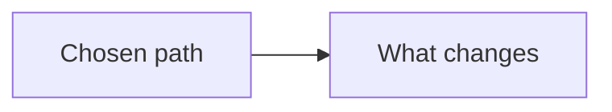

# ADR-NNNN: Title

Blank form. Copy this file to `docs/adr/NNNN-short-title.md`, fill it in, and link it from the case study it affects. This copy is not a decision.

Status values: `proposed`, `accepted`, `deprecated`, `superseded by ADR-NNNN`.

## Contents

- [Context](#context)
- [Decision](#decision)
- [Consequences](#consequences)
- [Alternatives considered](#alternatives-considered)

## Context

What problem is forcing a choice, and which constraints matter. Link the case study with a relative link. Example: [Humanoid architecture](../01-humanoid-on-robot-ai.md#architecture).

## Decision

The choice, in a few sentences. Include the date and the deciders when the copy is filled in.

## Consequences

What becomes easier, what becomes harder, and what follow-up work the choice creates.

### Positive

- Replace this item with what becomes easier.

### Negative

- Replace this item with what becomes harder.

### Follow-ups

- Replace this item with the work the choice creates.

## Alternatives considered

Name the other options and why they lost. Keep this short enough that a later reader can see the choice was real.

## Optional diagram

Delete this section if the decision does not need a picture.

## Index

[All case studies](../../README.md)
